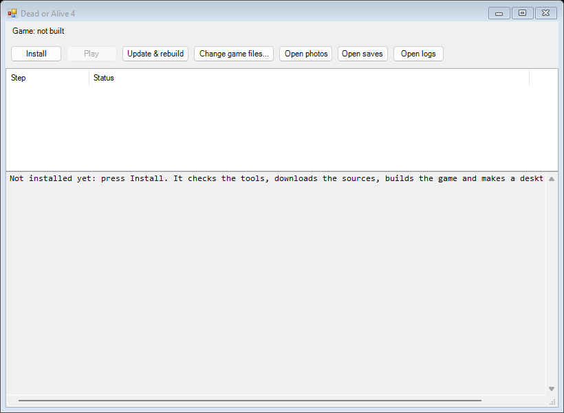
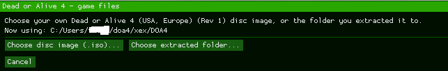
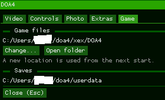
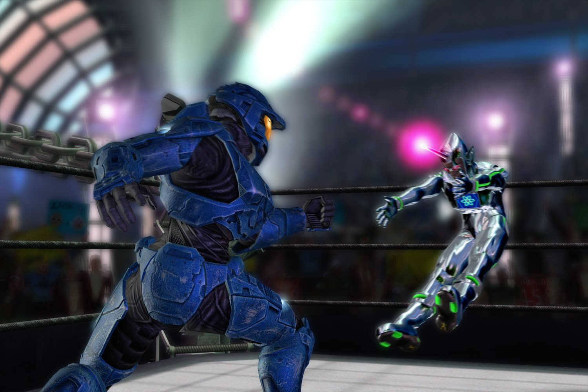

# Dead or Alive 4 — PC recomp

A native Windows build of **Dead or Alive 4** (Xbox 360), statically recompiled with the
[ReXGlue SDK](https://github.com/rexglue/rexglue-sdk). The game's code is translated ahead of time
into C++ (`generated/`); the SDK supplies the Xbox 360 runtime (kernel, GPU, audio, input). This
repository contains **no game data**: you build it, then run it against files extracted from your
own copy of the game.

This checkout is [parkerallan/doa4-recomp](https://github.com/parkerallan/doa4-recomp) plus the local
branch `perf-pacing` (frame pacing, Esc menu with Video / Controls / Photo / Extras / Game tabs,
graphics options, full-quality photos, a first-run setup that finds or extracts the game files). It builds against a local `rexglue-sdk` branch, `doa4-perf`. Neither
branch has been pushed anywhere; a fresh clone from GitHub gives the upstream versions without them
(see [Building from a fresh GitHub clone](#building-from-a-fresh-github-clone)).

## Quick start: the one-click launcher

The launcher installs what the build needs, downloads the sources, builds the game and makes a
desktop shortcut; afterwards it plays, updates and rebuilds. It is a small folder (`setup.bat` and a
`launcher` folder) made from this repository by `launcher\make_zip.ps1` (it writes
`DOA4-launcher.zip`, or `-Destination <folder>` writes the folder directly).

1. Put the `DOA4` folder somewhere whose path has only plain letters, digits and spaces (for
   example `C:\Games\DOA4`; the game cannot start from a path with accented or non-Latin letters).
   Everything the launcher downloads and builds stays inside it (about 4 GB).
2. Double-click `setup.bat` and press **Install**:
   - **Tools:** it checks for Git, LLVM 23.1.4 and Visual Studio 2026 Build Tools with the C++
     workload, lists any that are missing with their size, and installs them with winget after
     one confirmation (Visual Studio shows its own installer and asks for administrator rights).
   - **Code:** it downloads the game port and the ReXGlue SDK (about 2 GB the first time).
   - **Build:** it applies the two Windows fixes from step 4 and step 6 below and builds (a few
     minutes on a recent PC). Progress and every step's status show in the window.
   - **Shortcut:** a "Dead or Alive 4" shortcut on the desktop opens the launcher.
3. Press **Play**. On the first start the game asks for your disc image or extracted folder
   ([step 5](#5-the-game-files)).
4. Later: **Update & rebuild** fetches new commits and rebuilds ("nothing new" when there are none);
   **Change game files**, **Open photos**, **Open saves** and **Open logs** do what they say.



- `setup.bat -DryRun` shows what Install would install and do, without doing it.
- Which sources it builds is set in `launcher\config.ps1`: upstream `parkerallan/doa4-recomp`
  (`main`) with the SDK at `e8ce24f` by default. To build another fork or branch, change
  `GameRepoUrl` / `GameRef` (and `SdkRepoUrl` / `SdkRef`) and install into a new `DOA4` folder.
- It never pushes, stashes or overwrites your changes: Update stops and lists any file you changed
  by hand in its checkouts (other than its own two fixes).

The rest of this README is the same process by hand.

## Online play (netplay releases)

Both players need the **same** netplay release: the online handshake compares the compiled code, so
two different builds refuse each other. The releases are built by GitHub Actions from the `netplay`
branch and published as pre-releases named `netplay-v<major>.<minor>.<run>` on
[the Releases page](https://github.com/Dwreckgg/doa4-recomp/releases). A release holds the game's
exe and its two DLLs, never game data: you still need your own Dead or Alive 4 (USA, Europe) (Rev 1)
([step 5](#5-the-game-files)). It needs Windows 10/11 64-bit, a CPU with AVX2 and at least two cores,
and the Microsoft Visual C++ 2015-2022 x64 runtime.

**Getting the release** (any one of these):

- **Zip:** download `DOA4-netplay-vX.Y.Z-win64.zip`, unzip it into a folder of its own and start
  `dead_or_alive_4.exe`. On the first start it asks for your disc image or extracted folder.
  `SHA256SUMS.txt` (in the zip and on the page) holds the SHA-256 of the three files.
- **Launcher:** `DOA4-launcher.zip` (on the same page) installs and updates the newest release
  instead of building from source.
- **In the game:** **Check for Updates** in the Esc menu's **Online** tab downloads the newest
  release's three files, checks each against its `SHA256SUMS.txt` and swaps them in; restart the
  game afterwards. It is off while you are online.

**Playing:**

1. Press **Esc** and open the **Online** tab. One player presses **Host**; the tab shows **Your code**
   (**Copy** puts it on the clipboard). Send it to the other player.
2. The other player types it and presses **Join**. Both tabs then show the connection, the ping and
   the input delay (**Auto**, or **Manual**; the host decides the delay for both players).
3. The host presses **Start online session**. Both games restart into the session: P1 is the host,
   P2 the joiner, and everything from the title screen on (menus, character select, stage select)
   runs in lockstep on both PCs. The session plays on a separate copy of the save with everything
   unlocked; neither player's own save is written. **F9** shows the ping and input delay over the game.
4. **Leave online session** ends it; both games restart offline.

The first time you host, Windows may ask whether to allow the game through the firewall: allow it.

**What the messages mean:**

| Message | Meaning |
|---|---|
| "You have an older release (...): press Check for Updates, then restart the game." / "The other player has an older release (...): they need to press Check for Updates." | Two different releases: refused at the handshake. The older side updates. |
| "You run a self-built exe ..." / "The other player runs a self-built exe ..." | One game was built from source: both should use the latest release. |
| "The game files differ (...): both players need the same game files." | The named file groups of the two games' data differ. |
| "A direct connection is not possible between your networks; relay arrives with lobbies." | The routers change the port per destination (symmetric NAT), or every attempt to connect failed: the two PCs cannot reach each other directly yet. |
| "Waiting for the other player..." | The other player's input is late and the game holds. After 10 s: "The other player stopped responding. The session ended; both games restart." |
| "The games went out of sync. The session ended; both games restart." | A desync. Both games wrote diagnostics: send the session logs (below). |

**When the code does not connect:** the host's game asks the router to open its port (UPnP). If the
router does not, the host's tab offers **Strict router?** ("If the other player cannot connect, type
the code they show and press Reach out."); failing that, forward UDP port 7200 (DOA4 uses 7200-7215:
7200 unless another program holds it) on the host's router to the host PC.

**Session logs:** **Open session logs** in the Online tab opens `<saves folder>\netplay\sessions`
(the saves folder is the one the Game tab shows, [step 7](#7-run)). After a desync, send the newest
session's folder.

## Contents

1. [The game version](#1-the-game-version)
2. [Tools](#2-tools)
3. [Folder layout](#3-folder-layout)
4. [Get the sources](#4-get-the-sources)
5. [The game files](#5-the-game-files)
6. [Build](#6-build)
7. [Run](#7-run)
8. [Regenerating the recompiled code](#8-regenerating-the-recompiled-code)
9. [Host tests](#9-host-tests)
10. [Troubleshooting](#10-troubleshooting)
11. [Known bugs](#11-known-bugs)

## 1. The game version

The recompiled code matches one exact `default.xex`. Other regions or revisions will not work.

| | |
|---|---|
| Disc image used | `Dead or Alive 4 (USA, Europe) (En,Ja,Fr,De,Es,It,Zh,Ko) (Rev 1).iso` (Redump naming) |
| Title ID | `544307D1` |
| `default.xex` SHA-1 | `af8011945037b37c98fb8a78d5a4e844dd56c33f` |
| `default.xex` MD5 | `b2eb9c5df1f2060ae9c616945450289f` |
| Extracted size | about 6.8 GB |

Make the image from a disc you own. After extracting (step 5), check the hash:

```bat
certutil -hashfile xex\DOA4\default.xex SHA1
```

## 2. Tools

Versions are the ones this build was made with; nearby versions will probably work, but these are known
to.

| Tool | Version used | Where to get it |
|---|---|---|
| Windows 10/11, 64-bit, CPU with AVX2 (Intel Haswell / AMD Zen or newer) | Windows 11 | The build targets `x86-64-v3`. |
| Git | any recent | <https://git-scm.com> or `winget install Git.Git` |
| Visual Studio 2026 Build Tools (v18), workload **Desktop development with C++** | 18 | <https://visualstudio.microsoft.com/downloads/> — provides the Windows SDK, the MSVC libraries, **CMake 4.3.1** and **Ninja 1.13.2** (the build uses the bundled CMake and Ninja) |
| LLVM / Clang (the compiler; MSVC's compiler is not used) | 23.1.4 | `winget install LLVM.LLVM` (installs to `C:\Program Files\LLVM`) |
| Python 3 (for the ISO extractor and the symlink fix) | 3.14 | <https://www.python.org> or `winget install Python.Python.3.14` |

Optional: [extract-xiso](https://github.com/XboxDev/extract-xiso) as an alternative ISO extractor
(step 5).

## 3. Folder layout

Keep the three folders side by side. The code generator's manifest
(`dead_or_alive_4_manifest.toml`) looks for the game at `../xex/DOA4`, so this layout matters when
regenerating code (step 8); for building and running, any paths work.

```
doa4\
  doa4-recomp\     this repository
  rexglue-sdk\     the SDK, built from source together with the game
  xex\DOA4\        the extracted game files (default.xex, *.afs, movie\, SOUND\, dic\)
```

## 4. Get the sources

```bat
mkdir C:\doa4
cd /d C:\doa4
git clone https://github.com/parkerallan/doa4-recomp doa4-recomp
git clone https://github.com/rexglue/rexglue-sdk rexglue-sdk
cd rexglue-sdk
git checkout e8ce24f
git submodule update --init --recursive
cd ..
```

`e8ce24f` is the SDK commit that generated this port's code (v0.8.x; the manifest names
`0.8.1.4-dev.ge8ce24f`). CMake still prints a harmless "no v* tag reachable from HEAD" warning on a
fresh clone (fetching the tags does not silence it).

On this PC the working branches are `perf-pacing` (this repository) and `doa4-perf` (the SDK):
`git checkout perf-pacing` and `git -C ..\rexglue-sdk checkout doa4-perf`.

### Fix the SDK's symlinks (Windows)

Two SDK submodules (`libmspack`, `o1heap`) contain git symlinks. Unless symlinks are enabled
(Windows Developer Mode plus `git config --global core.symlinks true` *before* cloning), git
checks them out as small text files holding a path, and the build fails on them (for example
errors in `thirdparty/libmspack/cabextract/mspack/lzxd.c`, whose content is just
`../../libmspack/mspack/lzxd.c`). Replace them with real copies:

```bat
py -3 doa4-recomp\tools\fix_git_symlinks.py rexglue-sdk
```

It reports `replaced 16 symlink stub(s)` the first time and nothing afterwards; it is safe to run
again. `git status` in the SDK then shows the two submodules as modified (` m`), which is expected.

## 5. The game files

The recomp reads the game's files from a folder, not from the disc image. Xbox 360 discs use the
XDVDFS file system, which ordinary ISO tools cannot open.

**Usually nothing to do here:** the first time `dead_or_alive_4.exe` starts without game files it
shows a setup screen (step 7). Choose your disc image and it checks the version, asks where to
extract (default: a `DOA4` folder beside the image; it shows the space needed and free) and
extracts with a progress bar; or choose a folder you extracted before. The location is saved, and
the Esc menu's **Game** tab can change it later.



**By hand:** `tools/xdvdfs_extract.py` (a short Python script, no dependencies) does the same
extraction from a command line, and is what the first build used. It finds the game partition itself
(DOA4 is an XGD2 disc; its partition starts at byte `0xFD90000`).

```bat
cd /d C:\doa4
py -3 doa4-recomp\tools\xdvdfs_extract.py "Dead or Alive 4 (USA, Europe) (En,Ja,Fr,De,Es,It,Zh,Ko) (Rev 1).iso" xex\DOA4 --list
py -3 doa4-recomp\tools\xdvdfs_extract.py "Dead or Alive 4 (USA, Europe) (En,Ja,Fr,De,Es,It,Zh,Ko) (Rev 1).iso" xex\DOA4
```

The first command only lists the contents (a quick check that the image is readable); the second
extracts about 6.8 GB. Then check the `default.xex` hash (step 1). The ISO is not needed afterwards.

**Alternative:** [extract-xiso](https://github.com/XboxDev/extract-xiso) (download
`extract-xiso-Win64_Release.zip` from its releases) does the same job:
`extract-xiso -x -d xex\DOA4 "<image>.iso"`. It was not the tool used for this build, so check its
own help (`extract-xiso -h`) if that command line does not work.

## 6. Build

From a plain `cmd` window (not PowerShell), in `C:\doa4`:

```bat
call "C:\Program Files (x86)\Microsoft Visual Studio\18\BuildTools\Common7\Tools\VsDevCmd.bat" -arch=amd64 -host_arch=amd64
set "PATH=C:\Program Files\LLVM\bin;%PATH%"
cd doa4-recomp

rem Configure (once, or after deleting out\build):
cmake --preset win-amd64-release -DREXSDK_DIR=C:/doa4/rexglue-sdk "-DCMAKE_C_FLAGS=-march=x86-64-v3" "-DCMAKE_CXX_FLAGS=-march=x86-64-v3"

rem Build (every time):
cmake --build --preset win-amd64-release
```

- `VsDevCmd.bat` sets up the Windows SDK and puts Visual Studio's CMake and Ninja on `PATH`;
  LLVM goes first on `PATH` so `clang` / `clang++` are found (the presets name them).
- `REXSDK_DIR` builds the SDK from source alongside the game (no separate SDK install). Use forward
  slashes.
- The `-march=x86-64-v3` flags are required: the port's preset does not set a CPU level and the SDK
  uses SSSE3/AVX intrinsics, which fail to compile without it.
- The first build compiles the SDK and the large generated code and takes a while; later builds are
  incremental.

The result is in `out\build\win-amd64-release\`: `dead_or_alive_4.exe` with `rexruntime.dll` and
`TracyClient.dll` beside it.

## 7. Run

Start `out\build\win-amd64-release\dead_or_alive_4.exe`. On the first start (or when the saved
location has gone, e.g. an unplugged drive) the setup screen asks for your disc image or extracted
folder (step 5); after that the game starts straight away. The setup accepts only the supported
version (step 1) and explains why when it refuses one.

Optionally, a `run_doa4.bat` next to the exe can pass the folders on the command line. A
`--game_data_root` given this way overrides the saved location (and the Game tab's **Change…** is
then off); leave it out to use the setup's choice:

```bat
@echo off
rem GAME = the extracted folder holding default.xex. USERDATA = saves and the shader cache.
set GAME=C:\doa4\xex\DOA4
set USERDATA=C:\doa4\userdata
cd /d "%~dp0"
start "" dead_or_alive_4.exe --game_data_root="%GAME%" --user_data_root="%USERDATA%"
```

Saves and the shader cache go to `--user_data_root` if given, else to the folder in
`doa4_user_data` in `dead_or_alive_4.toml` (for example `doa4_user_data = "C:/doa4/userdata"`, with
forward slashes), else to `Documents\dead_or_alive_4`. Keep it outside OneDrive if you can (OneDrive
can lock files the game is writing). The Esc menu's Game tab shows the folder in use.



- Settings live in `dead_or_alive_4.toml` next to the exe; the **Esc** menu edits them (tabs
  Video, Controls, Photo, Extras, Game).
- **F6** shows a diagnostics overlay.

### Photos

- **F12** saves a photo of the game's own frame at the render scale, without any overlay. The Esc
  menu's Photo tab picks the format (PNG at monitor size by default, or PNG / JPG at full render size)
  and the folder (default `Pictures\DOA4`; **Open folder** opens it).
- With "Also save a full-quality copy when you save a snapshot to the in-game Album" ticked, saving a
  snapshot in the game's own photo mode also writes that photo at full quality to the same folder
  (the game's Album keeps a small, compressed copy). Only snapshots you save to the Album are copied.


- Logs: `out\build\win-amd64-release\logs\dead_or_alive_4_NNN.log`.

## 8. Regenerating the recompiled code

`generated/` is checked in, so a normal build does not need this. Only after adding a function
address to `hints.toml` (for example after a log line
`Call to invalid or unregistered function at guest address 0x...`):

```bat
cmake --build --preset win-amd64-release --target dead_or_alive_4_codegen
cmake --preset win-amd64-release -DREXSDK_DIR=C:/doa4/rexglue-sdk "-DCMAKE_C_FLAGS=-march=x86-64-v3" "-DCMAKE_CXX_FLAGS=-march=x86-64-v3"
cmake --build --preset win-amd64-release
```

The generator reads `../xex/DOA4/default.xex` (the folder layout in step 3). Reconfiguring is needed
only if new `.cpp` files were generated. `commands.txt` has the upstream author's notes on this loop.

## 9. Host tests

The mod code (unlocks, photo, graphics options, …) has small tests that build with `clang-cl` without
CMake or the game:

```bat
tests\host\run_photo_test.bat
```

One `run_<name>_test.bat` per module in `tests\host\`; each prints its own summary line (`PASSED: N
checks, 0 failures` or `<name>: all checks passed`). `py -3 -I tools\run_host_tests.py` runs them all
and judges each by that line and its exit code (`--only <name>` for some). The runners take Visual
Studio's `VsDevCmd.bat` from `DOA4_VSDEVCMD` and LLVM's `bin` folder from `DOA4_LLVM_BIN` when set
(the release workflow sets both).

## 10. Troubleshooting

| Symptom | Cause and fix |
|---|---|
| Compile errors in `thirdparty/libmspack/...` or `thirdparty/o1heap/...` | Symlink stubs: run `tools/fix_git_symlinks.py` (step 4). |
| Errors about SSSE3 / AVX intrinsics (`_mm_...` functions) | Configure was run without the `-march=x86-64-v3` flags. Delete `out\build\win-amd64-release` and configure again. |
| `imgui.h` or `rex/version.h` not found | The two include directories at the end of the `CMakeLists.txt` target setup are missing: they are local fixes in commit `5caf963` (in this branch's history). |
| `clang` not found / CMake picks the wrong compiler | LLVM's `bin` folder is not first on `PATH` in that window. |
| CMake warning `no v* tag reachable from HEAD` | Harmless; the build is not affected. |
| `no XDVDFS volume found` from the extractor | The file is not an Xbox / Xbox 360 game image (or is damaged). |
| The game does not start | Check the newest log in `logs\` (lines tagged `[doa4][SETUP]` say which game folder was used and why). |
| The game does not start after Check for Updates | Rename `dead_or_alive_4.exe.old` back to `dead_or_alive_4.exe` (and the same for a `.dll.old`), or use the launcher's Update. |
| The setup screen keeps coming back | The saved location could not be written to `dead_or_alive_4.toml` (the log says why), or the folder has moved. |
| "This path has characters that this build cannot use" | The game folder's path has characters outside the Windows code page (for example Japanese on an English Windows); the runtime cannot start from it. Use a folder whose path has plain letters and digits. |
| "This folder holds an unfinished extraction" | An earlier extraction was interrupted (the game was killed or the PC lost power). Delete that folder and extract again. |

## 11. Known bugs

| Bug | Status |
|---|---|
| Choosing **Ryu Hayabusa** (or **Brad Wong**, first reported as Zack) as player 1 crashed the game; Ryu also crashed the attract demo (Ryu vs Christie). | Fixed: the runtime put the game's data pool at guest address 0x00010000, so low that the game's "already relocated?" test (a table entry above the buffer address counts as a pointer) skipped Ryu's move-script table; Brad Wong's character-select model read a bad motion record from the same low pool (gone with the fix, not traced to its table). The game now keeps guest 0x00010000-0x0FFFFFFF unused (`src/doa4_lowmem.cpp`; the log says `[doa4][MEM] reserved guest ...`). |
| A rare crash with `Call to invalid or unregistered function at guest address 0x...` in the log, at one particular move or moment. | A function the recompiler missed. Add the address to `hints.toml` and regenerate (step 8). |

## Building from a fresh GitHub clone

The upstream repositories are at `parkerallan/doa4-recomp` `1d38c03` and `rexglue/rexglue-sdk`
`e8ce24f`. The steps above work for them too, with one addition: upstream lacks the two include-
directory fixes, so add these lines to `CMakeLists.txt` after `rexglue_setup_target(dead_or_alive_4)`:

```cmake
if(TARGET imgui)
    target_include_directories(dead_or_alive_4 PRIVATE $<TARGET_PROPERTY:imgui,INTERFACE_INCLUDE_DIRECTORIES>)
endif()
if(REXSDK_DIR)
    target_include_directories(dead_or_alive_4 PRIVATE ${CMAKE_BINARY_DIR}/rexglue-sdk/include)
endif()
```

The upstream build has none of the `perf-pacing` features (Esc menu, pacing fixes, photos).
